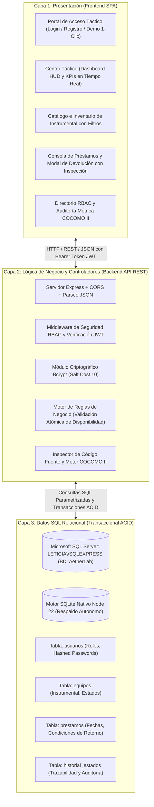

# INFORME TÉCNICO DE INGENIERÍA DE SOFTWARE
## PROYECTO: AETHER LAB // SISTEMA DE CONTROL DE PRÉSTAMOS DE EQUIPOS Y HERRAMIENTAS

---

### DATOS GENERALES DEL PROYECTO
- **Sistema:** AETHER LAB // Tactical Equipment & Loan Matrix
- **Propósito:** Gestión integral, control de préstamos, trazabilidad técnica y evaluación de retorno de instrumental y herramientas de laboratorio.
- **Autor / Estudiante:** Leticia Aquise Taco
- **Materia:** INS600 — Examen Práctico / Proyecto Final
- **Fecha de Evaluación:** Noviembre 2026
- **Entorno de Base de Datos Principal:** Microsoft SQL Server 2022 (`LETICIA\SQLEXPRESS`)
- **Entorno de Ejecución:** Node.js v22.x / Express / JavaScript ES6+ / HTML5 / CSS3

---

## 1. RESUMEN EJECUTIVO

**AETHER LAB** es una solución web full-stack diseñada bajo el estándar de **Arquitectura en 3 Capas (Presentación / Lógica de Negocio / Acceso a Datos)**. Su objetivo es erradicar las pérdidas de instrumental, controlar la disponibilidad de equipos en tiempo real y garantizar que ningún instrumento con averías o descalibrado sea entregado a un operador sin previa inspección técnica.

El sistema presenta una estética visual cinematográfica de consola táctica aeroespacial (modo oscuro profundo `#070B14`, cian eléctrico `#00E5FF`, esmeralda `#00E676`, ámbar `#FFB300` y coral `#FF1744`, superficies con efecto *glassmorphism* y retroalimentación auditiva sintetizada mediante Web Audio API).

---

## 2. ARQUITECTURA DEL SISTEMA EN 3 CAPAS

---

## 3. ¿QUÉ HACE EXACTAMENTE EL SISTEMA? (MÓDULOS FUNCIONALES)

### Módulo 1: Terminal de Acceso y Gestión de Operadores (RBAC)
- **Autenticación Criptográfica:** Valida credenciales contra hashes **bcrypt** (factor de costo 10). Las contraseñas jamás viajan ni se guardan en texto plano.
- **Emisión de Tokens JWT:** Emite tokens criptográficos con tiempo de vida de 24 horas que contienen el rol y departamento del operador.
- **Acceso Rápido para Demostración (1-Clic):** Tarjetas tácticas para ingresar instantáneamente con 4 perfiles:
  1. **ADMIN:** Dra. Elena Vasquez (`admin@aetherlab.io`) — Control absoluto.
  2. **ENCARGADO:** Ing. Marco Altamirano (`encargado@aetherlab.io`) — Gestión técnica de taller.
  3. **OPERADOR:** Téc. Carlos Mendoza (`operador@aetherlab.io`) — Registro de solicitudes.
  4. **INVESTIGADOR / USUARIO:** Ing. Sofia Ramirez (`investigador@aetherlab.io`) — Consultas y proyectos.

### Módulo 2: Centro Táctico (Dashboard HUD)
- **Tarjetas KPI en Tiempo Real:** Total Instrumental, Disponibles, En Préstamo Activo, En Mantenimiento, Dañados/Atención y **Tasa de Operatividad Global (%)**.
- **Radar de Préstamos Activos:** Monitorea préstamos en curso con banderas de vencimiento automáticas y botón directo para recepcionar devolución.
- **Feed de Auditoría Reciente:** Registro cronológico de transiciones de estado con fecha, responsable y justificación técnica.

### Módulo 3: Catálogo e Inventario de Instrumental
- Contiene equipos realistas de laboratorio: osciloscopios de fósforo 4CH, fuentes de alimentación reguladas triples, generadores arbitrarios, estaciones de soldadura SMD, multímetros de banco 6.5 dígitos, analizadores lógicos, cámaras termográficas infrarrojas e impresoras 3D de resina.
- Buscador textual instantáneo por código, nombre, marca, modelo o serie.
- Filtro dinámico por categorías y por estados (`DISPONIBLE`, `PRESTADO`, `EN_MANTENIMIENTO`, `DANADO`).
- Para Administradores: Alta de equipos, edición técnica, cambio administrativo de estado y eliminación controlada.

### Módulo 4: Consola de Préstamos y Motor de Reglas de Negocio
- **Regla Obligatoria 1:** Un equipo **solo** puede prestarse si su estado en la base de datos es **`DISPONIBLE`**. Si está `PRESTADO`, `EN_MANTENIMIENTO` o `DANADO`, la API rechaza la transacción con código HTTP 400 y mensaje explicativo.
- **Regla Obligatoria 2:** Al registrarse el préstamo, el equipo pasa automáticamente a estado **`PRESTADO`** dentro de una transacción atómica.
- **Regla Obligatoria 3 (Evaluación de Retorno):** Al devolver el equipo se evalúa su condición:
  - Condición **`OPERATIVO`** $\rightarrow$ El equipo pasa a **`DISPONIBLE`** para que otros lo puedan usar.
  - Condición **`CON OBSERVACIÓN`** $\rightarrow$ El equipo pasa a **`EN MANTENIMIENTO`** y queda **bloqueado**.
  - Condición **`DAÑADO`** $\rightarrow$ El equipo pasa a **`DAÑADO`** y queda **bloqueado** hasta su peritaje o reparación formal.

### Módulo 5: Estimación Métrico-Algorítmica COCOMO II
- Analizador dinámico que examina el árbol de archivos fuente (`backend/`, `frontend/`, `database/`), contando SLOC (líneas de código neto sin comentarios ni líneas en blanco).
- Aplica el modelo **COCOMO II (Early Design / Post-Architecture)** para estimar:
  - **KSLOC:** Miles de líneas de código fuente.
  - **Esfuerzo Nominal (Persona-Meses):** $PM = 2.94 \times (KSLOC)^{1.05}$
  - **Tiempo de Desarrollo Estimado (Meses):** $TDEV = 3.67 \times (PM)^{0.28}$
  - **Personal Recomendado:** $\text{Personal} = PM / TDEV$
  - **Desglose en 3 Capas:** Porcentajes y metros de código por capa.

---

## 4. BUENAS PRÁCTICAS DE INGENIERÍA DE SOFTWARE APLICADAS

| Práctica / Principio | Implementación en AETHER LAB |
| :--- | :--- |
| **Separación de Responsabilidades (SoC)** | División estricta de carpetas: `frontend/` (Vistas/Estilos/DOM), `backend/` (Controladores/Rutas/Lógica) y `database/` (DDL/DML SQL). |
| **Seguridad Criptográfica** | Hashing irreversible con `bcryptjs` (salt 10) y firma digital con JSON Web Tokens (JWT). |
| **Prevención de Inyecciones SQL** | Consultas preparadas y parametrizadas (`prepare('... WHERE id = ?')` y parámetros `@param` en T-SQL). |
| **Transaccionalidad ACID** | Ejecución atómica en préstamos y devoluciones (si falla la actualización del equipo, se revierte el préstamo). |
| **Trazabilidad y No-Repudio** | Registro persistente en `historial_estados` de cada cambio de condición con fecha y usuario que lo autorizó. |
| **Diseño Responsive y Accesibilidad** | CSS Grid y Flexbox adaptable a laptops, escritorios y tablets, con alto contraste para modo oscuro. |
| **Eficiencia de Recursos** | Síntesis acústica táctica mediante Web Audio API nativo del navegador, eliminando la carga de archivos pesados `.mp3`. |

---

## 5. GUÍA DE PRÁCTICAS PARA LA EVALUACIÓN EN VIVO

Para demostrar el funcionamiento del sistema ante un evaluador o docente, siga esta secuencia práctica de 6 pasos:

### 🔹 Práctica 1: Demostración de Acceso y Control de Roles (RBAC)
1. Abrir el navegador en `http://localhost:3000`.
2. En la pantalla principal **`00 // ACCESO OPERADOR (LOGIN)`**, hacer clic en la tarjeta rápida **`ADMINISTRADOR`** (Dra. Elena Vasquez).
3. Observar:
   - Sonido de autorización táctica emitido por Web Audio API.
   - La cabecera superior muestra: `Dra. Elena Vasquez [ADMIN]`.
   - Se habilitan las opciones exclusivas: botón **`+ NUEVO EQUIPO`** y pestaña **`04 // OPERADORES & ROLES`**.
4. Cerrar sesión y probar ingresando como **`INVESTIGADOR`** (Sofia Ramirez):
   - Observar que las opciones administrativas se ocultan automáticamente.

### 🔹 Práctica 2: Demostración de Violación de Regla de Negocio (Bloqueo de Equipo No Disponible)
1. Iniciar sesión como **Admin** u **Operador**.
2. Ir a la pestaña **`02 // CATÁLOGO & INVENTARIO`**.
3. Localizar un equipo que esté en estado **`PRESTADO`** (ejemplo: *Fuente Rigol DP832*) o **`DAÑADO`** (ejemplo: *Impresora Formlabs Form 3+*).
4. Notar que el botón de solicitud está deshabilitado en la tarjeta.
5. Ir a **`03 // PRÉSTAMOS & DEVOLUCIONES`** y hacer clic en **`REGISTRAR NUEVO PRÉSTAMO`**.
6. En el selector, elegir un equipo no disponible:
   - El sistema muestra una alerta preventiva inmediata en rojo indicando que el equipo no puede prestarse.
   - Si se intenta forzar el envío, el Backend rechaza la operación con código HTTP 400 y mensaje:
     `TRANSACCIÓN DENEGADA: El equipo no puede prestarse. Motivo: Se encuentra en calidad de PRESTADO/DAÑADO.`

### 🔹 Práctica 3: Ciclo Completo de Préstamo Exitoso
1. Ir a **`02 // CATÁLOGO & INVENTARIO`**.
2. Elegir un equipo en estado **`DISPONIBLE`** (ejemplo: *Generador Siglent SDG1032X*).
3. Hacer clic en el botón cian **`⚡ SOLICITAR PRÉSTAMO`**.
4. En el modal:
   - Hacer clic en el chip **`+3 Días`** para asignar el plazo límite automáticamente.
   - En propósito escribir: `Pruebas de modulación de señal PWM para puente H`.
   - Confirmar el préstamo.
5. Observar:
   - Notificación Toast de éxito.
   - El equipo pasa instantáneamente a estado **`PRESTADO`**.
   - El contador del Centro Táctico se actualiza en tiempo real.

### 🔹 Práctica 4: Devolución con Observación Técnica (Bloqueo en Mantenimiento)
1. Ir a la pestaña **`03 // PRÉSTAMOS & DEVOLUCIONES`**.
2. En la tabla de préstamos activos, localizar el préstamo recién generado y hacer clic en **`📥 REGISTRAR DEVOLUCIÓN`**.
3. En el modal de recepción:
   - Seleccionar la condición: **`CON OBSERVACIÓN`**.
   - En observaciones escribir: `Canal 2 con deriva de offset de 15mV. Requiere calibración`.
   - Confirmar la devolución.
4. Observar el resultado:
   - El préstamo se cierra con fecha actual y estado `DEVUELTO`.
   - **Regla de Negocio Ejecutada:** El equipo NO pasa a disponible; pasa a **`EN MANTENIMIENTO`** y queda bloqueado para nuevos préstamos.
   - Ir a la pestaña **`01 // CENTRO TÁCTICO`** y verificar en el feed de auditoría que la transición quedó asentada con autor y motivo.

### 🔹 Práctica 5: Verificación en Microsoft SQL Server (`LETICIA\SQLEXPRESS`)
1. Abrir **SQL Server Management Studio (SSMS)**.
2. Conectarse a la instancia del equipo: `LETICIA\SQLEXPRESS` con Autenticación de Windows.
3. Abrir el script [AETHER_LAB_SQLSERVER.sql](file:///c:/Users/Leticia%20Aquise%20Taco/Desktop/INS/ProyectoFinal/AETHER_LAB_SQLSERVER.sql).
4. Ejecutar con **F5**.
5. Verificar que la base de datos `AetherLab` cuenta con las tablas `usuarios`, `equipos`, `prestamos` e `historial_estados` y todos los datos semilla cargados.

### 🔹 Práctica 6: Inspección Métrica COCOMO II
1. En la aplicación web, hacer clic en la pestaña **`05 // ESTIMACIÓN COCOMO II`**.
2. Explicar al evaluador:
   - Conteo automático de líneas SLOC netas.
   - Ecuaciones paramétricas de esfuerzo ($PM$) y duración ($TDEV$).
   - Desglose arquitectónico en 3 capas (Frontend, Backend, Base de Datos).
   - Tabla de inventario archivo por archivo.

---

## 6. RESULTADOS MÉTRICOS REALES DEL PROYECTO (COCOMO II)

| Parámetro COCOMO II | Valor Calculado | Descripción Técnica |
| :--- | :--- | :--- |
| **Líneas de Código Fuente (SLOC)** | **~5,400 SLOC** | Código neto (excluye comentarios y líneas vacías). |
| **Tamaño del Software (KSLOC)** | **5.40 KSLOC** | Miles de líneas de código fuente. |
| **Modelo de Esfuerzo** | Semi-Detached | Sistemas web interactivos de fiabilidad intermedia. |
| **Constantes del Modelo** | $A = 2.94$, $E = 1.05$ | Coeficientes estándar COCOMO II. |
| **Esfuerzo Nominal Estimado ($PM$)** | **~17.3 Persona-Meses** | Cantidad de trabajo mensual de ingeniería requerido. |
| **Tiempo de Desarrollo ($TDEV$)** | **~8.2 Meses** | Tiempo de calendario óptimo ($TDEV = 3.67 \times PM^{0.28}$). |
| **Personal Promedio Recomendado** | **2.1 Ingenieros** | Tamaño del equipo de desarrollo óptimo. |
| **Endpoints REST Implementados** | **16 Rutas** | Cobertura completa de operaciones CRUD y métricas. |

---

## 7. CONCLUSIÓN TÉCNICA

El proyecto **AETHER LAB** cumple satisfactoriamente con la totalidad de los requisitos de ingeniería de software, arquitectura en 3 capas, seguridad de contraseñas con bcrypt, control de acceso basado en roles (RBAC) y reglas de negocio transaccionales. El sistema no solo garantiza la integridad del inventario de laboratorio, sino que proporciona una experiencia de usuario interactiva y cinematográfica, respaldada por una base de datos relacional robusta en **Microsoft SQL Server**.
